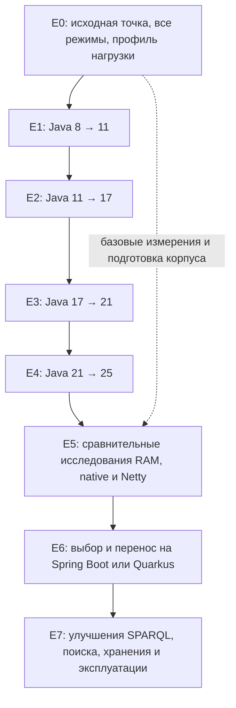

# План развития Blazegraph

Дата исходной оценки: 7 ноября 2026 года. Опорная ревизия форка: `d4ea2c106113d35dad22ff1c5f6406954302b6d5`.

Цель — получить сопровождаемый Blazegraph на современных версиях Java, сохранив существующие режимы, данные и API, а затем улучшать движок на основании воспроизводимых дефектов и измерений.
Документ задаёт последовательность развития и критерии завершения этапов. Конкретные изменения определяются перед соответствующим этапом; открытые архитектурные решения ниже являются предметом исследования.

## 1. Требования и рабочие правила

| ID | Требование | Основание |
| --- | --- | --- |
| R1 | Переходить последовательно: **Java 8 → 11 → 17 → 21 → 25**. Каждый переход завершается отдельным проверенным результатом. | Указание владельца форка |
| R2 | Сохранить **все текущие режимы**: standalone SPARQL-сервер, embedded Java API, HA и scale-out. | Указание владельца форка |
| R3 | Сохранить существующие точки входа, клиентские API, способы поставки и расширения запросов; точный перечень закрепить на этапе E0. | Предлагаемое правило совместимости для выполнения R2 |
| R4 | Обеспечить проверяемое обновление данных, резервное копирование, восстановление и откат. | Предлагаемое правило приёмки изменений БД |
| R5 | Выбрать Spring Boot или Quarkus после сравнения на нагрузке Blazegraph и оценки стоимости переноса. | Указание владельца форка; критерии выбора предложены в плане |
| R6 | Исследовать необходимость жёсткого ограничения памяти, Native Image и Netty; положительное решение заранее не принято. | Указание владельца форка |
| R7 | После стабилизации платформы и серверной обвязки внедрять улучшения из кода, issues и вики, начиная с воспроизведения и измерений. | Порядок задан владельцем; способ проверки предложен в плане |
| R8 | Учесть опыт перехода WDQS на QLever: проверить семантику SPARQL, управляемость нагрузки, объяснение планов и масштабирование. | Источник указан владельцем; направления проверки предложены в плане |

Предлагаемое правило поставки: на каждом принятом этапе явно указывать минимальный JDK, версию формата данных и поддержанные конфигурации. Необходимость длительно сопровождать несколько веток Java одновременно пока неизвестна; это отдельное решение о поддержке, а не условие пропуска промежуточного JDK.

## 2. Подтверждённая исходная точка

### Сборка и тесты

Полный штатный прогон `d4ea2c1` на Windows 11 и Axiom JDK `1.8.0_482-b10` завершился 7 ноября 2026 года: 24 записи reactor, 81 Surefire XML, 9 730 вхождений `testcase`, 6 371 уникальный `module/class/method`. Итоговых падений, успешных повторов и пропусков не было. Это результат одного запуска, а не доказательство отсутствия нестабильности (P ≈ 0,99 для вывода из сохранённых XML).

Локальные свидетельства: `target/axiomjdk8-full-comparison-d4ea2c1/comparison-summary.txt`, `current-reports/`, `current-summary.json`, `validation-summary.json` в том же каталоге. Каталог `target` является временным: в E0 эти материалы необходимо сохранить вне очищаемого дерева сборки с контрольными суммами.
Исходный архив сравнения — `target/axiomjdk8-full-comparison-9991446/baseline-reports`; SHA его исходного запуска неизвестен. Число `9991446` не следует выдавать за подтверждённую ревизию baseline.

Отдельный `bigdata-sails-test/src/test/java/com/bigdata/rdf/sail/webapp/TestDBpediaServiceIntegration.java` не входит в штатный `TestAll`. Проверки живой DBpedia по HTTPS учитываются отдельным отчётом; они не включены в приведённые числа.

### Архитектура и зависимости

По коду и POM на опорной ревизии (P ≈ 0,99):

- В корневом `pom.xml` пока установлены `source/target=1.7`, Maven Compiler Plugin 3.3, Surefire 2.18.1, Sesame 2.7.12, Jetty 9.4.12.v20180830 и Lucene 5.5.0. Успешный запуск на Java 8 не означает, что уровень исходников уже поднят до Java 8.
- `bigdata-core/pom.xml` объединяет хранилище, RDF и Sail/servlet-код. Чистое разделение движка и веб-обвязки ещё предстоит проверить и оформить.
- Jetty используется как сервер и как исходящий HTTP-клиент: `bigdata-core/bigdata/src/java/com/bigdata/bop/engine/QueryEngine.java`. Замена входящего HTTP-сервера не заменяет автоматически клиент для `SERVICE`.
- В `bigdata-core/bigdata/src/java/com/bigdata/io/DirectBufferPool.java` стандартный размер буфера — 1 048 576 байт, вместимость пула — `Integer.MAX_VALUE`; буферы создаются через `ByteBuffer.allocateDirect()` и возвращаются в пул для повторного использования.
- `analyticMaxMemoryPerQuery` в `bigdata-core/bigdata-rdf/src/java/com/bigdata/rdf/sparql/ast/QueryHints.java` по умолчанию равен `0`. Его обработка в `AbstractRunningQuery` не задаёт общего лимита памяти процесса.
- В `bigdata-core/bigdata-sails/src/java/com/bigdata/rdf/sail/webapp/ConfigParams.java` стандартное значение `queryThreadPoolSize` — 16; значение `0` выбирает пул без фиксированного верхнего числа потоков.

Наличие HA/quorum-тестов не доказывает работоспособность полноценного кластера. В checkout не найдены определения `HAJournalServer` и `com.bigdata.service.jini.JiniClient`; `ScaleOutClientFactory` динамически загружает провайдер. Часть federation-интеграций закомментирована в `bigdata-rdf-test/src/test/java/com/bigdata/rdf/store/TestAll.java` и `bigdata-sails-test/src/test/java/com/bigdata/rdf/sail/TestAll.java`. Происхождение и комплектность внешних компонентов пока неизвестны; это блокирующий вопрос для подтверждения R2, но не основание исключать эти режимы (P ≈ 0,99 для результатов поиска в данном checkout).

### Доступные JDK для последовательных этапов

| Этап | Локальный путь | Проверенная версия |
| --- | --- | --- |
| 8 | `C:\Users\Axiom\.jdks\axiomjdk-1.8.0_482` | `1.8.0_482-b10` |
| 11 | `C:\Users\Axiom\.jdks\axiomjdk-11.0.30` | `11.0.30+9-LTS` |
| 17 | `C:\Users\Axiom\.jdks\axiomjdk-17.0.18` | `17.0.18+10-LTS` |
| 21 | `C:\Program Files\Axiom\AxiomJDK-21` | `21.0.10+10-LTS` |
| 25 | `C:\Program Files\Axiom\AxiomJDK-25` | `25.0.2+12-LTS` |

Это инвентарь конкретной машины. Перед каждым этапом повторно фиксируются версия, поставщик, `JAVA_HOME` и JDK, выбранный Maven и тестовыми JVM.

## 3. Что меняет переход Wikimedia на QLever

Wikimedia переводит WDQS с Blazegraph на QLever. На дату проверки миграция ещё не завершена: в опубликованном плане исходные endpoints сохраняются как минимум до февраля 2027 года, целевая дата завершения перехода — 30 июня 2027 года. Это планы Wikimedia, которые могут измениться (P ≈ 0,99 для содержания страницы на дату проверки). [WDQS backend update — Learn](https://www.wikidata.org/wiki/Wikidata:SPARQL_query_service/WDQS_backend_update/Learn)

Переработка затрагивает и сервисный слой. В архитектурном документе **Quarkus выбран для `wdqs-proxy`**, который отделён от RDF-движка; это не перенос Blazegraph на Quarkus. Маршрутизация, метрики и управление нагрузкой рассматриваются отдельно от хранения данных. Требования к памяти proxy нельзя использовать как бюджет памяти БД (P ≈ 0,99). [WDQS Architecture re-design](https://wikitech.wikimedia.org/wiki/WDQS_Architecture_re-design)

Практические выводы для форка:

- Использовать QLever как один из эталонов сравнения на одинаковых данных и корректных общих SPARQL-запросах. Замена движка форка на QLever в этот план не входит.
- Разделять стоимость HTTP-обвязки, оптимизации запроса, исполнения и ввода-вывода. Смена фреймворка сама по себе не является доказанным решением проблем масштабирования (P ≈ 0,95).
- Составить корпус запросов с `OPTIONAL`, `VALUES`, `DISTINCT`, подзапросами, агрегатами, property paths, типизированными и языковыми литералами. Ожидаемые результаты определять по спецификации, учитывая мультимножества, пустые привязки и условия упорядочивания.
- Отдельно вести корпус расширений Blazegraph: `hint:*`, `bds:search`, named subqueries, GAS и custom `SERVICE`. Сравнивать их через явно описанные эквиваленты либо отмечать отсутствие сопоставимого сценария.
- При разборе различий проверять стандарт SPARQL, а не объявлять ответ любого другого движка автоматически правильным. Таблица Wikimedia содержит исторические оценки и неизвестные значения; она не заменяет проверку актуальных версий. [WDQS — Compare](https://www.wikidata.org/wiki/Wikidata:SPARQL_query_service/WDQS_backend_update/Compare)

Рабочее предположение о ценности форка: сохранение существующих Java-интеграций и расширений Blazegraph вместе с улучшением сопровождаемости. Целевой объём данных, интенсивность обновлений и необходимые SLO ещё неизвестны; их закрепляет E0. Обещание обслуживать полный масштаб Wikidata без измерений не принимается.

## 4. Последовательность этапов

Измерения памяти и сбор требований начинаются в E0 и повторяются на каждом JDK. Сравнительные прототипы серверных платформ и Native Image выполняются после принятия Java 25. До E6 не совмещать смену веб-фреймворка с переходом JDK; необходимые обновления зависимостей для совместимости выполняются в соответствующем Java-этапе.

### E0. Зафиксировать воспроизводимую исходную точку

Результаты этапа:

1. Сохранённый baseline: SHA, среда, параметры запуска, состав suites/testcases, XML, повторы, пропуски, логи и контрольные суммы. Переносимые результаты не зависят от сохранности `target`.
2. Реестр поддерживаемых API, форматов, CLI, конфигураций и поставок: executable JAR, WAR, embedded, клиентские библиотеки, Blueprints, HA и scale-out. Для каждого указан реальный запуск и ответственный компонент.
3. Найденные исходники/артефакты внешних HA/Jini-компонентов, их версии и лицензии; воспроизводимый изолированный стенд. Если комплект восстановить не удалось, причина и недостающие части зафиксированы, а готовность всех режимов не объявляется.
4. Матрица функциональных сценариев из раздела 5 выполнена сначала на Java 8. Linux-стенд дополняет Windows, особенно для кластерных сценариев.
5. Зафиксированные профили нагрузки: малый корпус корректности, типичный рабочий набор и набор для исследования предела ёмкости. Для каждого известны происхождение/контрольная сумма данных, доля чтения и обновлений, параллелизм, оборудование и ограничения внешнего окружения.
6. До сравнений установлены численные SLO и допустимые регрессии по каждому профилю: задержка, пропускная способность, ошибки, память, время загрузки и восстановления. Сроки разработки оцениваются после инвентаризации HA/scale-out.
7. Инвентарь зависимостей, доступных репозиториев и лицензий; план обновления сборочных плагинов и библиотек с проверкой доступных поддерживаемых версий.

Тестовая база для начала: `bigdata-core-test/bigdata/src/test/com/bigdata/quorum/TestHA3QuorumSemantics.java`, `bigdata-core-test/bigdata/src/test/com/bigdata/ha/halog/TestHALogWriter.java`, `bigdata-core-test/bigdata/src/test/com/bigdata/service/TestSplitJoin.java` и оба упомянутых `TestAll`. Нужные реальные кластерные сценарии добавляются сверх этих компонентных тестов.

**Критерий завершения:** исходная точка воспроизводится, матрица всех режимов проверена, измерительный стенд и ограничения сопоставления определены. Исследовать совместимость Java 11 можно параллельно с инвентаризацией, но подтвердить сохранение всех режимов без этих результатов нельзя.

### E1–E4. Поэтапно обновить Java

Для каждого перехода сначала проверить предыдущий артефакт на новом runtime, затем сборку и тесты новым JDK. Повышение минимального JDK и уровня исходников оформляется явно внутри этого этапа. Где доступен `--release`, использовать его для выбранной целевой Java; запуск Maven, тестов и полученного артефакта проверять отдельно.

| Этап | Основная работа | Проверки сверх общего критерия G |
| --- | --- | --- |
| E1: 8 → 11 | Обновить совместимые сборочные плагины; сначала установить явную базу Java 8 вместо `1.7`, затем принять минимум Java 11. Разобрать удалённые из JDK зависимости и обращения к внутренним API. | Проверить `javax.xml.bind.DatatypeConverter` в `bigdata-core/bigdata-rdf/src/java/com/bigdata/rdf/internal/InlineHexUUIDURIHandler.java`; выбрать явную зависимость или стандартную замену с сохранением байтового результата. Проверить CLDR/локали, TLS и сервисную загрузку. Наличие импорта — кандидат несовместимости, а не уже воспроизведённое падение (P ≈ 0,99). |
| E2: 11 → 17 | Разобрать сильную инкапсуляцию и совместимость транзитивных библиотек; принять минимум Java 17. | Проверить reflection, сериализацию, загрузку провайдеров, очистку файлов/direct-буферов. Каждый временный `--add-opens` должен иметь узкую область, причину и задачу удаления. |
| E3: 17 → 21 | Принять минимум Java 21; проверить изменения кодировок и окружения. | Проверить UTF-8 на Windows, RDF/CSV, конфигурации, пути и не-ASCII данные; повторить нагрузочные профили. Внедрение virtual threads в движок не совмещать с миграцией. |
| E4: 21 → 25 | Принять минимум Java 25; проверить lifecycle ресурсов, Security Manager, JNI и зависимости с Unsafe. | Разобрать `finalize()` в `BigdataSail`, `QueryEngine`, `AbstractJournal`; явное закрытие должно проверяться тестами. Проверить Security Manager в тестовой инфраструктуре; его зависимость в production HA заранее не предполагается. |

Изменения JDK — основания для проверок, а не список доказанных дефектов форка. UTF-8 по умолчанию действует с JDK 18, сильная инкапсуляция — с JDK 17, finalization устаревает с JDK 18; это разные изменения и их нельзя сводить к одному флагу запуска (P ≈ 0,99). [Oracle: миграция с JDK 8](https://docs.oracle.com/en/java/javase/25/migrate/migrating-jdk-8-later-jdk-releases.html)

Зависимости обновлять отдельными проверяемыми изменениями внутри нужного этапа. Переход Sesame → RDF4J требует отдельной оценки совместимости Sail/Repository и клиентского API (исследование 1 в E7); он не считается автоматическим следствием нового JDK. При обновлении Lucene-анализаторов (исследование 3 в E7) проверять токенизацию, relevance и необходимость перестроения text index на копии данных. Если совместимость зависимости блокирует переход JDK, необходимую часть исследования выполнить в этом Java-этапе, не откладывая её до E7.

**Общий критерий G для каждого E1–E4:**

- Штатный reactor проходит `mvn -B -ntp --fail-at-end verify` на целевом Axiom JDK; результат подтверждён XML, а не только `BUILD SUCCESS`.
- Нет необъяснённых падений, повторов, новых пропусков или исчезнувших тестов. Каждый нестабильный тест исследован; изменение состава тестов объяснено.
- Матрица раздела 5 проходит на целевой Java. Компонентные HA-тесты не подменяют реальный кластер.
- Копия `.jnl`, созданная предыдущим принятым выпуском, открывается, читается, обновляется, закрывается и восстанавливается согласно утверждённой политике совместимости.
- Предыдущий выпуск и резервная копия позволяют выполнить отработанный откат. Обратное открытие уже обновлённого файла старым бинарником не считается безопасным без отдельного теста.
- Результаты нагрузки укладываются в пороги E0. Зафиксированы SHA, JDK, параметры, зависимости и поддержанные конфигурации; предусмотрен повторный длительный прогон конкурентных сценариев.

Диагностический запуск с `maven.test.failure.ignore=true` допустим для сбора всех ошибок, но не является итоговым критерием этапа. Одновременно запускать Maven в одном checkout нельзя из-за общих generated sources и `target`; независимым сборкам нужны разные рабочие деревья.

### E5. Исследовать память, Native Image и Netty

#### Память и необходимость жёсткого лимита

Результат — бюджеты по режимам и решение, где нужен именно принудительный предел процесса/контейнера, а где достаточно внутренних квот и управления нагрузкой. Числа заранее неизвестны.

- Измерить heap, direct/off-heap, стеки потоков, метаданные/JIT и общую память процесса. Для Linux отдельно учитывать RSS/PSS и фактический учёт памяти cgroup; файловый кэш и отображённые страницы не складывать с RSS без проверки пересечений. Для Windows фиксировать сопоставимые process/commit-метрики.
- Отдельно снять старт, загрузку данных, прогрев, устойчивую нагрузку, пики параллельных запросов, обновления, backup/recovery и медленных клиентов. Потребление штатного тестового набора не выдавать за минимальную память production.
- Проверить существующие квоты `MemoryManager`, обходные пути вроде `NativeDistinctFilter`, общий `DirectBufferPool`, пулы потоков и очереди. `-Xmx` ограничивает heap, а не всю память процесса (P ≈ 0,99 по найденным direct-аллокациям).
- До уменьшения `poolCapacity` проверить схему удержания буферов: сам `DirectBufferPool` предупреждает о риске взаимоблокировок при ограничении пула. Снижение значения без проверки прогресса запросов не считать готовым решением.
- Под нагрузкой проверить admission control, отмену и тайм-ауты, освобождение ресурсов, восстановление доступности после отказа. При принудительной остановке из-за внешнего лимита проверить целостность и восстановление журнала.

**Критерий завершения:** для каждого профиля указаны измеренный пик, запас, внутренние ограничения, потребность во внешнем пределе и поведение при его достижении. Если требуемый бюджет не обеспечен, ограничение отмечается как невыполненное.

#### Native Image

Сначала определить сценарий, которому мешает JVM: время до первого успешного запроса, плотность размещения либо конкретный бюджет памяти. Затем сравнить native с JVM на том же движке, данных и функциональном контракте.

Проверить reflection, ресурсы, сериализацию, `ServiceLoader`, динамическую загрузку классов, JNI, анализаторы, custom services и внешние HA/Jini-компоненты. Это не универсально запрещённые возможности: часть требует reachability metadata; произвольное добавление неизвестного при сборке кода требует отдельного решения (P ≈ 0,99). [GraalVM: reachability metadata](https://www.graalvm.org/latest/reference-manual/native-image/metadata/)

GraalVM/Mandrel и native-компилятор — отдельный toolchain; их наличие не следует из установки Axiom JDK. Проверить лицензии, целевые ОС/архитектуры, воспроизводимость, диагностику и стоимость сопровождения.

**Критерий завершения:** решение «нужен / не нужен / отложен» с измерениями времени старта, пиковой памяти, throughput, p95/p99, загрузки данных и восстановления. При принятии native определить область его поддержки и критерии выпуска. Полнофункциональная JVM-поставка с embedded API и всеми режимами сохраняется по R2–R3; native не заменяет Java-библиотеку.

#### Netty и сетевой слой

Оценивать независимо три области: входящий SPARQL HTTP, исходящий клиент `SERVICE` и бинарный транспорт HA. У каждой свои протоколы, тайм-ауты, lifecycle и тесты. Перенос всего сетевого кода одной заменой не планируется.

| Вариант | Проверяемая польза | Основная стоимость/риск |
| --- | --- | --- |
| Текущий Jetty после необходимых обновлений | Контрольная точка без смены модели сервера | Сохраняющаяся связность текущего кода |
| Spring Boot + Servlet/Jetty или Tomcat | Перенос существующих servlet-контрактов и эксплуатационной обвязки | Миграция Servlet API, конфигурации и lifecycle |
| Spring Boot + WebFlux/Reactor Netty | Streaming, обработка большого числа соединений и управление потоком данных | Адаптация servlet-обработчиков и блокирующего движка; WebFlux не поддерживает WAR |
| Quarkus + Vert.x/Netty | Интеграция HTTP, метрик и JVM/native-поставок | Проверка переносимости существующих API и зависимостей; Servlet через Undertow исследуется отдельно от Quarkus REST |
| Сервер непосредственно на Netty | Возможность точного управления протоколом и буферами | Собственное сопровождение HTTP-обвязки, lifecycle, диагностики и совместимости |

Эти варианты относятся к разным слоям: Netty может быть частью фреймворка. Реактивная HTTP-модель не превращает блокирующее исполнение SPARQL и дисковый ввод-вывод в неблокирующие операции; размещение таких задач и ограничение очередей проверяются отдельно (P ≈ 0,99). [Spring Boot: web servers](https://docs.spring.io/spring-boot/how-to/webserver.html), [Quarkus: HTTP](https://quarkus.io/guides/http-reference/), [Quarkus: reactive routes](https://quarkus.io/guides/reactive-routes)

Для Netty проверить direct-буферы, освобождение `ByteBuf`, streaming без накопления полного ответа, медленного читателя, обрыв соединения и отмену запроса. Watermarks сигнализируют о состоянии записи, но не являются самостоятельным жёстким RAM-лимитом (P ≈ 0,99). [Netty: WriteBufferWaterMark](https://netty.io/4.2/api/io/netty/channel/WriteBufferWaterMark.html)
Netty native transports (`epoll`/`kqueue`) и Native Image — разные механизмы; поддержка их сочетаний проверяется отдельно для выбранной платформы. Windows и Linux входят в сравнение. [Netty: native transports](https://netty.io/wiki/native-transports.html)

**Критерий завершения:** для каждой области сети есть решение «сохранить / заменить / отложить» с данными о пропускной способности, задержке, памяти, отмене и стоимости сопровождения. Без измеримого выигрыша собственный Netty-сервер не является вариантом по умолчанию.

### E6. Выбрать Spring Boot или Quarkus и перенести серверную обвязку

Выбор не предрешён. Практический исходный вариант для сравнения — Spring Boot с Servlet-стеком, поскольку текущие обработчики используют Servlet API; это рабочая рекомендация по объёму адаптации, а не доказанное преимущество производительности (P ≈ 0,8).

Оба прототипа должны выполнять один контракт: запуск/остановка, SPARQL query/update, namespace API, streaming результатов, `SERVICE`, отмена, конфигурация и диагностические endpoints. Прототипы работают с тем же ядром; нельзя одновременно менять оптимизатор и приписывать результат фреймворку.

При выборе оценить:

- результаты E5, сохранность API/поставок R2–R3, трудоёмкость адаптации, тестирования и сопровождения;
- поддержку требуемого JDK актуальными версиями фреймворка и библиотек; версии перепроверяются на старте E6;
- миграцию `javax.servlet` → `jakarta.servlet`, если она требуется выбранным стеком; пространства имён нельзя просто смешать;
- зависимости servlet-контейнера и исходящего HTTP-клиента: управление версиями через BOM не должно незаметно менять семантику `SERVICE`;
- выбор между сохранением servlet-обработчиков и их адаптацией; наличие Undertow не делает Quarkus REST servlet-реализацией (P ≈ 0,99). [Quarkus REST migration](https://quarkus.io/guides/rest-migration/)

Целевая граница модулей: движок и embedded API → адаптер жизненного цикла → выбранная серверная платформа. Входящий HTTP и исходящий клиент являются отдельными адаптерами. Это направление рефакторинга, точные Maven-модули определяются по зависимостям на старте E6.
Владение `Journal`/`IIndexManager` и пулами должно быть явным: переданный embedded-приложением ресурс закрывается согласно его контракту, созданный сервером — при остановке сервера. Проверить повторный старт/остановку и отсутствие оставшихся потоков и файловых блокировок.

**Критерий завершения:** записано решение с отклонёнными вариантами, поставка на выбранном фреймворке проходит G и матрицу раздела 5. Если вариант требует исключить WAR или иной действующий контракт, он не может быть принят без решения о совместимом способе сохранения R3. Экспериментальный код отклонённых вариантов удалён из выпуска.

### E7. Улучшать движок и эксплуатацию

Вики является источником идей и описанием существующего поведения. Дата страницы и соответствие текущему коду проверяются для каждого пункта. Уже реализованная функция не переносится в backlog как новая.

#### Три самостоятельных исследования

Каждое исследование проводится отдельно на профилях и данных, зафиксированных в E0. Для каждого готовится собственный отчёт с измерениями, проверками корректности и решением «принять / отклонить / отложить»; общий вердикт вместо трёх решений не допускается.

**1. Sesame → RDF4J: API и совместимость данных**

- Сопоставить публичные API, Sail/Repository, клиентские библиотеки и точки расширения. Проверить применимые сценарии standalone, embedded, HA и scale-out, включая транзакции, SPARQL query/update и расширения Blazegraph.
- На копиях данных проверить открытие, чтение, запись и повторное открытие существующих `.jnl`. Сравнить адаптеры и варианты миграции, отдельно проверить восстановление исходного варианта и откат.
- **Принять** переход, если все поддерживаемые контракты проверены, совместимость `.jnl` сохранена либо подтверждён безопасный путь миграции, а откат воспроизводим. **Отклонить** при нарушении контракта или потере данных; **отложить**, если не хватает зависимостей, потребительских сценариев либо проверяемого пути обновления.

**2. Улучшенные B+Tree: измерения и варианты структур**

- Снять baseline точечных и диапазонных чтений, записи, split и checkpoint на фиксированных профилях E0. Для каждого сценария записать задержки/пропускную способность, CPU, I/O, RAM и размер данных.
- Сравнить подходящие алгоритмы и структуры данных без заранее выбранной замены. Проверить результаты чтения, транзакционность, конкурентные обновления, аварийное восстановление и повторное открытие.
- **Принять** вариант при воспроизводимом выигрыше на целевом профиле без регрессии корректности. При изменении формата отдельно подтвердить совместимость, миграцию и восстановление. **Отклонить** вариант с потерей гарантий или выходом за допустимые пороги E0; **отложить**, если выигрыш не подтверждён либо профиль недостаточен.

**3. Lucene Analyzer: поведение полнотекстового поиска**

- Зафиксировать поддерживаемые языки и fallback, нормализацию и токенизацию отдельно для индексируемого документа и поискового запроса. Проверить наблюдаемое поведение `bds:search`, prefix, rank и relevance на регрессионном корпусе.
- Проверить согласованность после обновлений, rebuild и reopen; измерить производительность поиска и обновлений, RAM, размер индекса и время/стоимость перестроения. Сохраняется собственный B+Tree text index Blazegraph; переход на Lucene IndexWriter не рассматривается этим исследованием.
- **Принять** анализатор при подтверждённой языковой семантике и приемлемых измерениях с воспроизводимым rebuild/rollback. **Отклонить** при некорректной токенизации или неприемлемой стоимости; **отложить**, если не определены языки/fallback либо нет достаточного корпуса и профиля.

| Приоритет | Направление | Первое действие и критерий принятия |
| --- | --- | --- |
| 1 | Корректность SPARQL | Воспроизвести [issue #250: DISTINCT + VALUES](https://github.com/blazegraph/database/issues/250) в `bigdata-rdf-test/src/test/java/com/bigdata/rdf/sparql/ast/eval/TestBasicQuery.java` или соседнем ticket-тесте. Статус в форке пока неизвестен. Исправление принимается с минимальным регрессионным тестом и сверкой семантики. |
| 1 | Совместимость и диагностика запросов | Разобрать корпус различий WDQS/QLever и стандартные тесты SPARQL. Сохранить расширения Blazegraph, документировать нестандартное поведение и безопасный путь изменения. |
| 2 | JOIN, кардинальности, RTO | Использовать имеющиеся RTO/QueryHints/Explain; на конкретном запросе сопоставить оценки, фактические размеры промежуточных результатов и время. Изменять оптимизатор после локализации ошибки оценки или выбора плана. Проверить также overhead выборок и lifecycle памяти в `bigdata-core/bigdata/src/java/com/bigdata/bop/joinGraph/rto/JGraph.java`. |
| 2 | Большие `ORDER BY` | Проверить память и время `bigdata-core/bigdata/src/java/com/bigdata/bop/solutions/MemorySortOp.java`; TODO внешней сортировки является кандидатом. Реализация рассматривается только после воспроизведения ограничения и определения требований к временному диску. |
| 2 | Property paths | Зафиксировать циклы, глубину, ветвление, начальные ограничения, корректность и расход памяти; сравнить одинаковые запросы с QLever на зафиксированных данных. Улучшение должно сохранять семантику и давать выигрыш в заявленном классе нагрузки. |
| 2 | Полнотекстовый поиск | Развивать существующие `bds:search` и B+Tree text index с Lucene-анализаторами: языки, нормализация, ranking, prefix, rebuild и согласованность при обновлениях. База регрессий — `bigdata-rdf-test/src/test/java/com/bigdata/rdf/lexicon/TestFullTextIndex.java`. |
| 3 | BTree, RWStore, Journal и ввод-вывод | Профилировать загрузку, commit, чтение, удержание страниц и большие литералы. Любое изменение формата требует отдельного плана совместимости, миграции и восстановления. |
| 3 | Управление нагрузкой и наблюдаемость | Развивать результаты E5: очереди, лимиты, отмена, метрики плана/запроса, p95/p99, расход памяти и `SERVICE`. Проверять возврат ресурсов после завершения и отказа. |
| 3 | Эксплуатация и документация | Обновить инструкции standalone/embedded/HA/scale-out, резервного копирования и обновления; убрать ссылки на недоступные зависимости из критического пути сборки. |

Полнотекстовый индекс Blazegraph уже существует: он использует B+Tree и Lucene Analyzer для токенизации; его нельзя описывать как отсутствующую возможность или как обычный Lucene IndexWriter-индекс. Prefix-поиск, relevance/rank и языковые анализаторы описаны в вики; поддержка произвольного `REGEX` индексом из этого не следует (P ≈ 0,99). [FullTextSearch](https://github.com/blazegraph/database/wiki/FullTextSearch)

Для остальных направлений исходные описания — [QueryOptimization](https://github.com/blazegraph/database/wiki/QueryOptimization), [Explain](https://github.com/blazegraph/database/wiki/Explain) и [RWStore](https://github.com/blazegraph/database/wiki/RWStore). Конкретные утверждения этих страниц сверяются с реализацией опорной ревизии перед изменением.

Направления RTO, Explain, хранения и issue #250 также обсуждались в [чате об аналогах Blazegraph](codex://threads/01a1ac42-5064-71c2-932c-6c98eb4e93ec). Это источники кандидатов; готового согласованного backlog тот чат не задавал.

Каждое принятое улучшение оформляется отдельно: проблема → воспроизведение/профиль → изменение → регрессия или benchmark → сравнение с предыдущей ревизией. Выигрыш публикуется только для измеренного профиля. Дефекты, обнаруженные во время E0–E6 и мешающие текущему этапу, исправляются сразу; отложен именно самостоятельный функциональный backlog.

## 5. Матрица сохранения режимов и поведения

| Область | Обязательные сценарии на исходном и каждом новом этапе |
| --- | --- |
| Standalone JAR и WAR | Запуск, health/readiness, namespace API, query/update по HTTP, форматы результата, streaming, timeout/cancel, остановка и повторное открытие журнала. |
| Embedded Java API | `Journal`, `BigdataSail`/repository, транзакции, commit/rollback, переданный и собственный `IIndexManager`, совместная работа с хост-приложением и корректное закрытие. |
| Остальные действующие API | Клиентские библиотеки, Blueprints и CLI из реестра E0; обратная совместимость проверяется потребительскими сценариями, а не только компиляцией самого форка. |
| HA | Реальный запуск кворума, запись и чтение, потеря лидера, сетевое разделение и потеря кворума, перевыборы, перезапуск узла, catch-up/resync, replay HALog, согласованность подтверждённых записей. Топология и ожидаемые гарантии фиксируются в E0. |
| Scale-out | Реальные metadata/data services и провайдер, загрузка, распределённый query/update, split/join, перезапуск сервисов и проверка сохранности данных. |
| Данные и восстановление | Открытие копии старого `.jnl`, обновление и повторное открытие, backup/restore, аварийное завершение, откат через проверенную копию. |
| SPARQL и расширения | Стандартный корпус и отдельный корпус `hint:*`, `bds:search`, GAS, named subqueries, custom services; проверка результатов и ошибок. |
| Федерация | Детерминированный локальный SPARQL endpoint: bindings/OPTIONAL, пустые результаты, ошибка, timeout, redirect и форматы ответа. Живые DBpedia/WDQS — отдельные opt-in проверки, учитывающие изменение внешнего окружения. |

Для конкурентных сценариев предусмотреть повторные stress-прогоны и контролируемые расписания. Fray — кандидат на отдельный инструментальный профиль: сначала проверить актуальную совместимость JDK, Windows/Linux, Maven и используемого тестового фреймворка. Его пригодность для Java 8 заранее не утверждается, штатный прогон он не заменяет.

## 6. Правила измерений и выпуска

- Сначала корректность, затем производительность. Перед измерением проверяется эквивалентность результатов; для неупорядоченного SPARQL-ответа порядок строк сам по себе не является отличием.
- Сравнивать зафиксированные SHA, версии движков, данные, оборудование, файловую систему, ограничения памяти, JVM-параметры и настройки индексов. Обновление данных между сравнениями исключается или учитывается явно.
- Разделять холодный запуск и прогретую нагрузку, выполнение на сервере и передачу ответа по сети. Публиковать throughput, p50/p95/p99, ошибки/тайм-ауты, память и длительность загрузки/восстановления; число повторов и разброс указывать вместе с результатом.
- QLever и другие движки запускать на изолированном стенде. Публичный endpoint не использовать как воспроизводимый benchmark локального движка. Различающиеся возможности и семантику отражать в отчёте, а не скрывать из сравнения.
- Для каждого этапа сохранять отчёт о тестах, составе набора, нестабильности, производительности, совместимости данных и откате. Непрошедший режим нельзя считать сохранённым по наличию классов в исходниках.
- Изменения сборки, переход JDK, исправление дефекта, перенос сервера и оптимизации должны быть независимо проверяемыми изменениями. Нельзя объяснять итоговый выигрыш одной причиной, если одновременно менялось несколько независимых частей.

## 7. Открытые решения и условия их закрытия

| Решение | Что пока неизвестно | Когда и по каким данным закрывается |
| --- | --- | --- |
| Комплектность HA/scale-out | Где находятся необходимые внешние компоненты и как они собираются | E0: исходники/артефакты, лицензии, запуск и реальные интеграционные тесты; блокирует подтверждение R2. |
| Целевые нагрузки и SLO | Объём данных, чтение/запись, параллелизм, требования к задержке и восстановлению | E0: профили и численные пороги до сравнений; без них результаты остаются исследовательскими. |
| Совместимость выпусков | Период поддержки старых JDK/API и точные границы формата/отката | E0 и перед каждым выпуском: реестр потребителей и проверенные сценарии обновления. |
| Жёсткий RAM-лимит | Какие развёртывания требуют принудительного предела и какого размера | E5: пиковое потребление, запас и испытания перегрузки для каждого профиля. |
| Native Image | Есть ли полезный сценарий и приемлема ли цена совместимости | E5: измерения JVM/native, покрытие режимов, сборка, диагностика и сопровождение. |
| Netty | В какой из трёх сетевых областей оправдана замена | E5: отдельное сравнение транспорта и интеграции с движком. |
| Spring Boot или Quarkus | Что даёт лучший результат при сохранении R2–R4 | E6: одинаковый функциональный контракт, результаты E5 и стоимость сопровождения. |
| Sesame → RDF4J | Совместимость API/Sail/Repository, клиентов и существующих `.jnl` | Исследование 1 в E7: контракты всех режимов, проверенный путь адаптации/миграции и отката; отдельное решение с доказательствами. |
| Улучшенные B+Tree | Есть ли измеримый выигрыш подходящей структуры без потери гарантий | Исследование 2 в E7: baseline чтения/записи/checkpoint, ресурсы, корректность, транзакции и восстановление; отдельное решение с доказательствами. |
| Lucene Analyzer | Как изменить анализаторы, сохранив поведение и собственный B+Tree text index | Исследование 3 в E7: языки, поиск, rebuild/reopen, стоимость и регрессии; отдельное решение с доказательствами. |
| Backlog улучшений | Какие проблемы воспроизводятся и что ограничивает реальные нагрузки | E7: минимальные примеры, профили и привязка к текущему коду/версии вики. |

Начальное практическое действие — E0: сохранить свидетельства успешного Java 8-прогона, восстановить проверяемую матрицу всех режимов и закрепить профили нагрузки. После этого следующий платформенный результат — Java 11 по критерию G.
